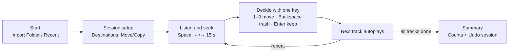

# KHole – Product Spec

## Összefoglaló

A KHole egy Macre készülő, ingyenes, nyílt forráskódú DJ-segédapp: egy feldolgozatlan zenemappán lehet vele billentyűzetről, másodpercek alatt végigmenni – belehallgatni, a trackeket célmappákba szórni vagy kidobni.

- **Kinek:** DJ-knek, akiknek tele van a letöltés- vagy promómappájuk, és a Finder + Quick Look túl lassú.
- **Cél:** egy track sorsa 5–15 másodperc alatt eldőljön, egér nélkül.
- **Nyelv:** a felület angol.
- **Alapelvek:** billentyűzet először · semmi nem vész el véglegesen · minimális beállítás, gyors indulás · natív Mac-kinézet.
- **Ami nem cél (most):** metaadat-szerkesztés, DJ-szoftver integráció, könyvtárkezelés. A KHole a DJ-szoftver *előtt* dolgozik, a fájlokon.

## A javasolt folyamat kritikája

Az irány jó, de az eredeti terv túl sok lépést tesz az első belehallgatás elé, és a teljes képernyős előnézet megtöri a tempót. A javítás: egy beállítóképernyő, utána egyetlen állandó munkanézet.

| Eredeti ötlet | Erősség | Gyengeség | Javaslat |
| --- | --- | --- | --- |
| Külön döntés: rendezés vagy csak törlés | Világos szándék | Plusz lépés, és később nem lehet váltani | Nincs külön mód: ha nincs célmappa, az app „csak törlés” módban fut. Célmappa bármikor hozzáadható |
| Másolás vagy áthelyezés választás | Biztonságosabb, ha valaki másolni akar | Még egy képernyő | Egy kapcsoló a beállítóképernyőn, alapból **Move** |
| Célmappák, majd hotkeyek külön lépésben | Testreszabható | Két lépés, amit egy is elvisz | Mappa hozzáadásakor automatikusan kap egy számot (1–0), átírható. Húzással is lehet célmappára dobni |
| Mappastruktúra listázása DJ-playlist módra | Ismerős logika | Mély mappáknál sok kattintás | Oldalsáv mappafával + kapcsoló: **Include subfolders** (minden track egy listában) |
| Kattintásra teljes képernyős waveform | Nagy, jól látható | Ki-be lépés minden tracknél, ez öli a tempót | A waveform mindig látszik a lista felett. Döntés után azonnal indul a következő track |
| Space = lejátszás/szünet | Ez a DJ-reflex | – | Marad |
| ±15 mp tekerés nyíllal és egérrel | Gyors | A fel/le nyíl kell a listához | ←/→ = ±15 mp, ↑/↓ = előző/következő track, kattintás a waveformra = ugrás |
| BPM, key megjelenítés | Döntéshez kell | Saját elemzés lassú lehet | Először a tagekből olvasunk. Elemzés csak ha nincs tag, a háttérben |
| Metaadat-szerkesztés | Kényelmes lenne | Nagy munka, a Meta app jobban csinálja | Teljes tagszerkesztő nincs. A listában a **Title**, az **Artist** és a **fájlnév** helyben átírható (katt a kijelölt sorra), visszavonható. Minden máshoz **Reveal in Finder** és **Open in…** |

**Ami eddig hiányzott és sokat számít:**

- **Visszavonás.** Minden mozgatás és törlés visszavonható (Cmd+Z), mert gyors tempónál sok a félrenyomás.
- **Session folytatása.** Ha bezárod az appot, ott folytatod, ahol abbahagytad.

## Fő felhasználói folyamat

Egyszer beállítod a sessiont, utána egyetlen ciklus fut, amíg el nem fogy a mappa. Az első tracket kb. 10 másodperccel az app megnyitása után már hallod.

1. **Start:** mappa importálása vagy egy korábbi session folytatása.
2. **Session setup:** célmappák (vagy egy sem, ha csak takarítasz), Move/Copy, lejátszás kezdőpontja.
3. **Triage ciklus:** belehallgatás, egy gombos döntés, a következő track automatikusan indul.
4. **Summary:** mi hova került, egy gombos visszavonás.

**Ha 9-nél több célmappa kell:** az 1–0 gombok 10 gyors helyet adnak. Ezen felül az **M** gomb egy *Move to…* keresőt nyit: beírod a mappa nevének elejét, Enter, és ott van. Így a célmappák száma korlátlan, a leggyakoribb 10 pedig egy gombon marad.

## Képernyők

Három képernyő van, a munka 95%-a a harmadikon folyik.

### 1. Start

- Középen kis blokk: **Import Folder** gomb, alatta „or drop a folder here”.
- Alatta **Recent sessions**: az utolsó 5 mappa, hány track maradt bennük. Egy kattintás, és folytatod.

### 2. Session setup

Egy képernyő, minden alapértékkel kitöltve. **Start** gombbal azonnal indulhat.

- **Source:** a kiválasztott mappa, tracksszám, **Include subfolders** kapcsoló.
- **Destinations:** üres lista + **Add folder**. Minden mappa automatikusan kap számot (1–0, összesen 10), ami átírható. A többi mappa az M (Move to…) keresővel érhető el. Üres lista esetén felirat: „No destinations – cleanup mode: keep or delete only”.
- **When sorting:** Move / Copy kapcsoló (alap: Move).
- **Start playback at:** 0% / 25% / 40% (alap: 0%, személyre állítható).
- **After action:** auto-play next track (alap: be).

**Elemzés az import után, egy menetben.** A mappa betöltésekor a KHole beolvassa az összes track tagjeit (cím, előadó, BPM, key, hossz). Ahol a BPM vagy a key hiányzik, ott rögtön ezután a háttérben elemez. A setup képernyőn közben egy progress sáv fut („Analyzing 37 / 480”), a Start gomb már ekkor is nyomható: a lista azonnal megjelenik, a hiányzó értékek folyamatosan töltődnek be. Az eredmények cache-be kerülnek, így ugyanazt a fájlt soha nem elemzi kétszer. A fájlok tagjeibe nem ír vissza.

A beállítások mappánként megmaradnak, legközelebb egyből lehet indítani.

### 3. Triage (fő munkanézet)

Felülről lefelé:

1. **Waveform** a teljes szélességben: lejátszófej, idővonal, kattintásra ugrás. Alatta egy sor: cím, előadó, BPM, key, hossz, formátum, bitráta.
2. **Track lista** (mint egy DJ-szoftver böngészője): #, cím, előadó, BPM, key, hossz, státusz. Fejlécre kattintva rendezhető, a fejlécet húzva az oszlopok átrendezhetők. Az aktuális track kiemelve, a kezelt trackek halványítva maradnak, egy szűrővel elrejthetők.
3. **Destination bar** alul: célmappa-csempék számmal és névvel, + a Trash csempe. Húzással is lehet rájuk dobni, a csempe számlálót mutat.

Balra összecsukható **oldalsáv** a mappafával, ha nincs bekapcsolva az Include subfolders. Fent egy vékony **progress sáv**: „132 / 480 done”.

### 4. Summary (session végén)

Hány track ment melyik mappába, hány a Kukába, mennyi idő. **Undo session** gomb biztonsági hálónak, és **Open destination in Finder**.

## Billentyűparancsok

Minden művelet egy gomb, módosító nélkül. Minden kiosztás átírható a beállításokban.

| Billentyű | Művelet |
| --- | --- |
| Space | Lejátszás / szünet |
| ← / → | Vissza / előre 15 mp |
| Shift + ← / → | Vissza / előre 60 mp |
| ↑ / ↓ | Előző / következő track (nem dönt, csak lép) |
| 1–0 | Áthelyezés / másolás az adott célmappába, majd következő track |
| M | Move to…: kereső a 10-en felüli célmappákhoz |
| Backspace | Kukába, majd következő track |
| Enter | Keep: marad a helyén, következő track |
| Cmd + Z | Utolsó művelet visszavonása |
| Cmd + R | Megmutatás a Finderben |
| ? | Billentyűparancsok áttekintése |

## Feature-lista

Az MVP 12 feature, ezzel a saját mappáid már feldolgozhatók. A többi csak akkor jön, ha napi használatban hiányzik.

| # | Feature | Fázis |
| --- | --- | --- |
| 1 | Mappa importálása (gomb + drag & drop), Include subfolders, tagek beolvasása + hiányzó BPM/key elemzése a háttérben, cache-sel | MVP |
| 2 | Célmappák hozzáadása, 1–0 gombok + Move to… kereső (M) | MVP |
| 3 | Move / Copy kapcsoló | MVP |
| 4 | Track lista: cím, előadó, BPM, key, hossz (tagekből), rendezhető és átrendezhető oszlopok, kezelt trackek szűrője | MVP |
| 5 | Waveform lejátszófejjel, kattintásra ugrás | MVP |
| 6 | Space, ←/→ ±15 mp, ↑/↓ trackváltás | MVP |
| 7 | Lejátszás kezdőpontja (alap 0%, személyre állítható) | MVP |
| 8 | 1–0 = célmappába, Backspace = Kukába, Enter = keep, auto-next | MVP |
| 9 | Undo (Cmd+Z), több lépés mélyen | MVP |
| 10 | Session mentése és folytatása | MVP |
| 11 | Destination bar húzható csempékkel | MVP |
| 12 | Reveal in Finder | MVP |
| 13 | Mappafa az oldalsávban | v1.1 |
| 14 | Hotkeyek átírása a beállításokban | v1.1 |
| 15 | Summary képernyő + Undo session | v1.1 |
| 16 | Elemzés pontosságának finomítása (technóra hangolt BPM-tartomány) | v1.1 |
| 17 | Tempó állítása az előnézetben, keylockkal | v1.1 |
| 18 | Elemzett BPM/key visszaírása a tagekbe (opcionális) | Later |
| 19 | Duplikátum-jelzés (ugyanaz a track a célmappában) | Later |
| 20 | Szűrés BPM / key / formátum szerint | Later |
| 21 | Rekordbox XML / Traktor export | Later |
| 22 | Windows build | Later |
| 23 | Helyben szerkesztés a listában: Title, Artist (tag), fájlnév (átnevezés), Cmd+Z-vel | MVP |

Tudatosan kimarad: teljes metaadat-szerkesztés (BPM, key, album, borító stb.; erre ott a Meta app), streaming-források, felhős szinkron.

## Fájlbiztonság

A KHole sosem töröl véglegesen, és nem ír felül semmit. Ez az első naptól így működik, nem utólagos javítás.

- **Törlés = macOS Kuka.** A Kukából a Finderben is visszaállítható.
- **Névütközés:** ha a célmappában már van ugyanilyen nevű fájl, nem írjuk felül. Kérdés helyett automatikusan sorszámot kap: `track (2).mp3`. Ilyenkor egy rövid értesítés jelzi, hogy a fájl új nevet kapott.
- **Undo napló:** minden művelet (honnan, hová, mikor) bekerül egy session-naplóba, ebből megy a Cmd+Z és az Undo session.
- **Eltűnt vagy megváltozott fájl:** ha a Finderben közben átmozgatsz valamit, a lista frissül, és nem omlik össze az app.
- **Tag írása (Title, Artist):** a fájl egy klónjába írunk, ellenőrizzük (az új érték visszaolvasható, a hossz, a többi tag és a borító változatlan), és csak utána cseréljük le vele az eredetit. Csak az az egy mező változik; a többi frame (pl. Serato cue pontok) érintetlen. Átnevezés soha nem ír felül másik fájlt.
- **Csak a kiválasztott mappákhoz nyúl.** A forráson és a célmappákon kívül semmit nem olvas és nem ír.

## Technikai stack és licenc

Tauri 2 + React + shadcn/ui, a KHole maga GPL-3 alatt nyílt forráskódú. Így a legjobb hangkönyvtárak is használhatók.

| Réteg | Eszköz | Licenc | Megjegyzés |
| --- | --- | --- | --- |
| App keret | Tauri 2 (Rust backend) | MIT / Apache | Kicsi, gyors, később Windows is |
| UI | React + TypeScript + shadcn/ui + Tailwind | MIT | Kész Tauri-sablonok vannak |
| Waveform | [wavesurfer.js](https://npmjs.com/package/wavesurfer.js) | BSD-3 | Regions plugin a jelölőkhöz |
| Fájlműveletek | Rust: mozgatás, másolás, Kuka | – | Undo napló a Rust oldalon |
| Tagek olvasása | Rust tagolvasó könyvtár | ellenőrizni | MP3, FLAC, WAV, AIFF, M4A |
| Tempó + keylock | [Rubber Band](https://breakfastquay.com/rubberband/license.html) | GPL | v1.1, nyílt forrásként rendben van |
| BPM / key elemzés | [Essentia](https://essentia.upf.edu/licensing_information.html) | AGPL, modellek NC | Csak ingyenes, nem kereskedelmi verzióban |

**Kockázatok, amiket prototípusban kell kipróbálni:**

- A Mac WebView (WebKit) melyik formátumokat játssza le natívan. Az MP3 és a WAV biztos, a FLAC és az AIFF valószínű, de ezt tesztelni kell.
- Waveform-generálás sebessége nagy WAV/AIFF fájloknál. Lehet, hogy a Rust oldalon kell előre kiszámolni és cache-elni.
- Ha valaha pénzes lenne, a GPL/AGPL részeket le kell cserélni vagy licencelni.

**Audioformátumok (utánanézve).** A Tauri a Mac saját WebKit-motorjával játszik le, ami az Apple Core Audio-ra épül, így a DJ-formátumok többsége natívan megy. A fájlokat a Tauri asset protokollja streameli a lejátszóba.

| Formátum | Lejátszás | Megjegyzés |
| --- | --- | --- |
| MP3, WAV | Igen | Minden böngészőmotor kezeli |
| AAC / M4A | Igen | Apple saját formátuma |
| FLAC | Igen, macOS Catalina (Safari 13) óta | [forrás](https://www.testmuai.com/learning-hub/flac-browser-support/) |
| ALAC | Igen, Safari 13+ macOS | Ugyanott |
| AIFF | Igen | Spike-ban tesztelve (24 bit, 10 perc, seek is) |
| Ogg, WebM | Nem garantált | DJ-gyakorlatban ritka. Egy Tauri-hibajegy szerint a WebM macOS-en nem szól ([forrás](https://github.com/tauri-apps/tauri/issues/9514)) |

Ha egy formátum mégsem szól, a tartalék a Rust oldali dekódolás. Ezt csak akkor építjük, ha a prototípus szerint kell.

## Design irányelvek

Úgy nézzen ki, mintha az Apple csinálta volna: semmi dísz, minden elem a döntést segíti.

- **Rendszerkinézet:** SF Pro betű, natív ablakkeret, áttetsző oldalsáv. Világos/sötét mód a rendszert követi, de a sötét az elsődleges.
- **Egy hangsúlyszín: lila, #895CF4.** Csak a lejátszófejnél, az aktív tracknél és a frissen használt célmappa-csempén.
- **A waveform a hős:** a legnagyobb elem, kontrasztos, a lejátszott rész más árnyalatú.
- **Sűrű lista**, mint egy DJ-szoftverben: 28–32 px sormagasság, monospace számok a BPM-hez és az időhöz.
- **Visszajelzés animáció helyett:** egy rövid villanás a célmappa-csempén és egy számláló, nem toast-üzenet.
- **Üres állapotok** egy mondattal elmagyarázzák, mi a teendő („Drop a folder to start digging”).

## Döntések

| Kérdés | Döntés |
| --- | --- |
| Kezelt track a listában | Halványítva marad, szűrővel elrejthető |
| Enter (keep) | Helyben hagyja a fájlt |
| Lejátszás kezdőpontja | Alap 0%, beállításban állítható |
| Platform | Egyelőre csak Mac |
| Formátumok | Mind: MP3, WAV, AIFF, FLAC, M4A, ALAC |
| 9-nél több célmappa | 1–0 gombok + M = Move to… kereső |
| Repo | [github.com/tomi2400/KHole](https://github.com/tomi2400/KHole.git) |

**Még nyitott:** a domain. (Az AIFF a prototípusban gond nélkül szól, lásd `docs/spike-results.md`.)
